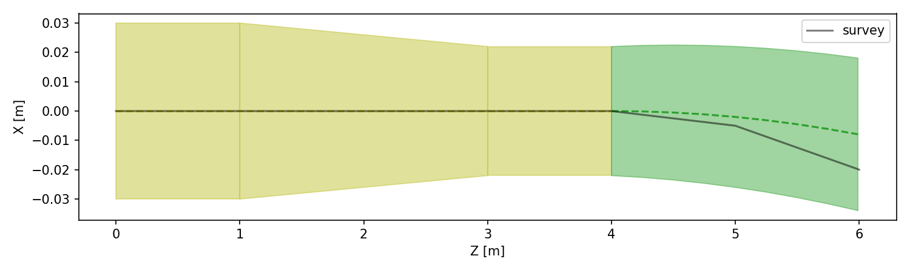
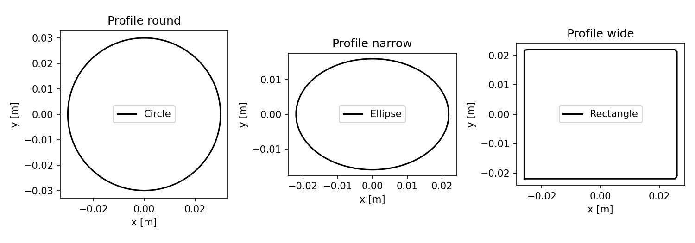
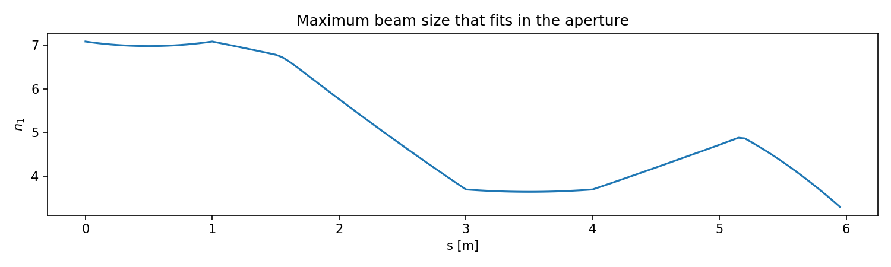
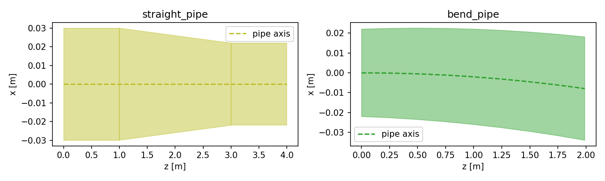
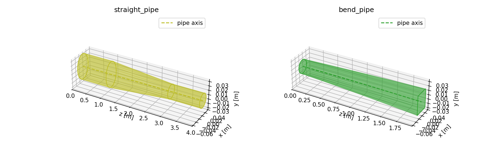
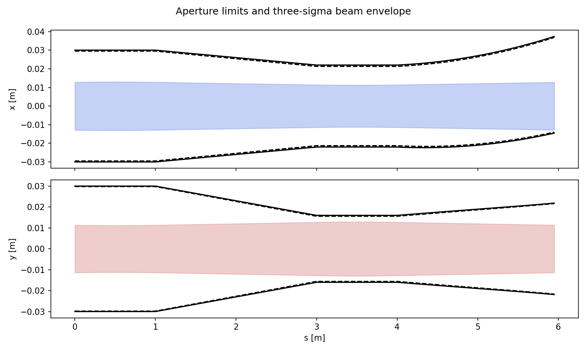
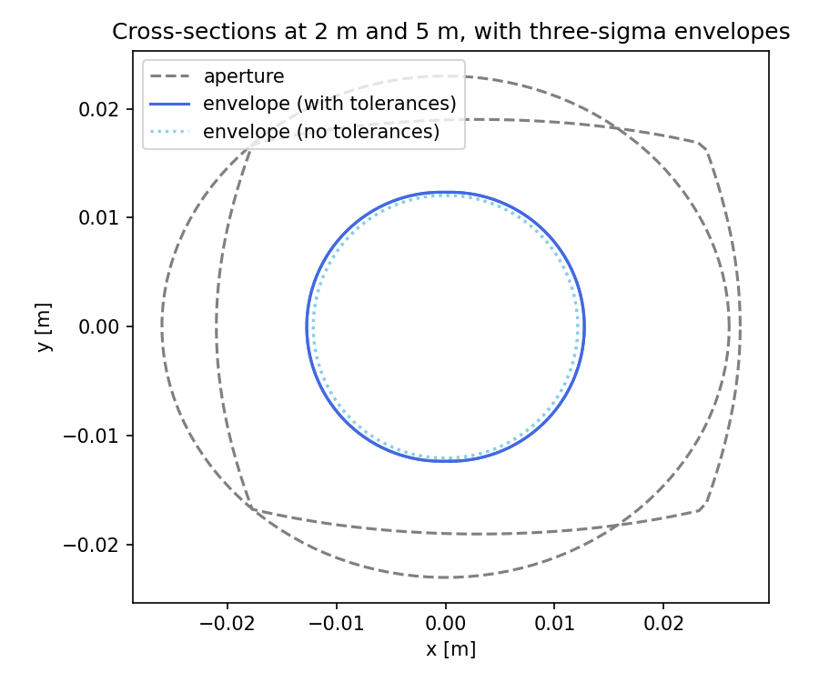

.. _aperture-user-guide:

==================
Aperture modelling
==================

An aperture model describes the physical chamber of a machine.
It combines transverse profiles into pipes, installs those pipes along the survey,
and can be used to compare the resulting cross-sections with a beam envelope, as well
as to install limit elements in the line for loss tracking.

Two objects manage the model:

* ``env.aperture`` (:class:`xtrack.EnvAperture`) defines named profiles and pipes,
  shared by the lines in that environment.
* ``line.aperture`` (:class:`xtrack.LineAperture`) installs pipes on a particular
  line, queries geometry, computes beam clearance, and plots the results.

The example below uses one FODO cell, a straight pipe, and a slightly curved pipe.
A pipe can span several lattice elements; its profiles do not have to sit at
element boundaries.
All lengths, offsets, and mechanical tolerances in this example are in metres.

.. contents:: On this page
   :local:
   :depth: 2

Build a FODO cell
=================

Create a focusing quadrupole, a drift, a defocusing quadrupole, and a weak bend.

.. literalinclude:: examples/aperture_fodo.py
   :language: python
   :start-after: # start-lattice
   :end-before: # end-lattice

Define profiles and pipes
=========================

A profile defines a transverse shape. Here we use a circle, an ellipse, and a
rectangle.

Each ``profile.place(at=...)`` creates a profile position within a pipe.
The straight pipe stays circular through the focusing quadrupole, narrows to
an ellipse through the drift, and stays elliptical through the defocusing quadrupole.
The curved pipe transitions from that same ellipse to a rectangle. Its curvature
is set independently to that of the bend. The pipe therefore bends more gently than the
reference trajectory, progressively displacing the chamber relative to the beam.

   Visualisation of the aperture section we are creating.

.. literalinclude:: examples/aperture_fodo.py
   :language: python
   :start-after: # start-profiles
   :end-before: # end-profiles

Each profile can also be plotted on its own:

.. literalinclude:: examples/aperture_fodo.py
   :language: python
   :start-after: # start-profile-plot
   :end-before: # end-profile-plot

   The three profile shapes used by the two pipes.

Tolerances belong to profile positions and installed pipes. The profile shapes
themselves contain only geometry. Here, ``tol_r`` is a radial mechanical tolerance;
``tol_x`` and ``tol_y`` specify horizontal and vertical tolerances.

Install the pipes
=================

Install the straight pipe at the start of ``qf`` and the curved pipe at the start of ``bend``.
Both use the same elliptical profile at their shared boundary, with matching position
and orientation, so the chamber is continuous. Beyond the join, the pipe axis and
the survey gradually separate because their curvatures differ.

.. literalinclude:: examples/aperture_fodo.py
   :language: python
   :start-after: # start-placements
   :end-before: # end-placements

``build_model()`` captures the line's survey and pre-computes quantities necessary for
further aperture computations (such as caching polygons and their longitudinal bounds).
While here we call it explicitly, the function will also be called implicitly when needed.
In a more complex model than ours, the same pipe definition can be installed several times
under different placement names.

Explore the model
=================

Named views let you inspect profiles, pipes, and installed pipe positions.

.. literalinclude:: examples/aperture_fodo.py
   :language: python
   :start-after: # start-exploration
   :end-before: # end-exploration

``get_pipe_table()`` reports each installed pipe's interval, while
``get_bounds_table()`` reports the individual installed profiles and their footprints
along the survey. The two profiles at 4 m belong to different installed pipes but
describe the same cross-section at the join.
The final profile sits near 5.99 m, just before the bend's exit. Its longitudinal
footprint has a nonzero width because the profile plane is tilted relative to the survey.

.. literalinclude:: examples/aperture_fodo.py
   :language: python
   :start-after: # start-tables
   :end-before: # end-tables

``get_cross_sections_at_s`` returns interpolated polygons in the local survey frame.
With ``extents=True``, it also returns intersections with the horizontal and vertical
axes. Geometry and tolerances are returned separately: the tolerances do not shrink
the returned aperture polygon or its axis intersections.

.. literalinclude:: examples/aperture_fodo.py
   :language: python
   :start-after: # start-sections
   :end-before: # end-sections

Within a pipe, profile-position tolerances interpolate between neighbouring profile
centres, and the installed pipe's tolerances are added component by component.
For example, at the start of the upstream pipe, ``tol_r`` is 0.2 mm and ``tol_x``
is 0.3 mm. At a pipe boundary, aperture geometry can interpolate between pipes,
but tolerances are taken from the active pipe rather than interpolated across the boundary.

Compute beam clearance
======================

``halo_params`` supplies the normalised emittances and beam uncertainty margins.
For this example, equal halo parameters define a circle in normalised coordinates.
We also allow a 0.5 mm closed-orbit uncertainty. The bend creates dispersion, so
the momentum spread also contributes to the beam envelope.

.. literalinclude:: examples/aperture_fodo.py
   :language: python
   :start-after: # start-halo
   :end-before: # end-halo

``get_aperture_sigmas_at_s`` computes ``n1``, the largest beam scale in sigma units
that fits inside the aperture, including the configured uncertainty margins and
mechanical tolerances. It returns a results table and the Twiss table sampled at
the requested positions. The minimum ``n1`` identifies the limiting sampled location.

``get_envelope_at_s`` instead returns the envelope at a chosen sigma level.
Its ``cross_section`` column contains the envelope polygon for each position.

.. literalinclude:: examples/aperture_fodo.py
   :language: python
   :start-after: # start-computation
   :end-before: # end-computation

   Beam clearance along the cell, sampled at 5 cm intervals.

The ``rays`` method samples directions and is a useful starting point,
but methods ``exact`` and ``bisection`` exist as well (see the physics
manual or method docstrings for more details on these).
If you already have a sampled Twiss, use ``get_aperture_sigmas_for_twiss``
or ``get_envelope_for_twiss`` to reuse them.

Visualise the model
===================

Individual pipes
----------------

``pipe.plot()`` shows a pipe definition in its own frame, before installation on a line.
Use ``plane='zx'`` for a horizontal projection of its physical geometry, or
``plane='sx'`` for a view in which the curved axis is straightened.
The vertical projections are available as ``'zy'`` and ``'sy'``.
Here we plot both pipe definitions and enlarge the transverse scale for visibility:

.. literalinclude:: examples/aperture_fodo.py
   :language: python
   :start-after: # start-pipe-plot
   :end-before: # end-pipe-plot

   Horizontal projections of the straight and curved pipe definitions, with transverse
   dimensions enlarged to show their shapes.

``pipe.plot_3d()`` draws the pipe surface and the profiles defining it.
``frame='curved'`` preserves the physical curvature; ``frame='straight'``
displays the pipe in straightened coordinates. Both plots below use the curved frame,
with transverse dimensions enlarged for visibility.

.. literalinclude:: examples/aperture_fodo.py
   :language: python
   :start-after: # start-pipe-3d
   :end-before: # end-pipe-3d

   Pipe surfaces and defining profiles in three dimensions. The downstream pipe's
   axis bends while its cross-section transitions from an ellipse to a rectangle.

Floor projection
----------------

``plot_floor_projection`` draws the installed pipes and the reference trajectory
in the global Z-X plane. This plot is interactive, and clicking on pipes gives
more metadata about their properties and locations.

.. literalinclude:: examples/aperture_fodo.py
   :language: python
   :start-after: # start-floor-plot
   :end-before: # end-floor-plot

   A continuous chamber with a straight upstream pipe and a curved downstream pipe.

Data behind the plots
---------------------

The plotting helpers have corresponding data queries. ``get_extents_at_s`` supplies
the aperture limits for ``plot_extents``. ``get_envelope_at_s`` supplies the envelope
polygons and extents, as shown above. ``get_aperture_sigmas_at_s`` supplies the ``n1``
values.

.. literalinclude:: examples/aperture_fodo.py
   :language: python
   :start-after: # start-plot-data
   :end-before: # end-plot-data

Longitudinal limits and beam envelope
-------------------------------------

``plot_extents`` plots the aperture's horizontal and vertical axis intersections
together with a beam envelope. Its horizontal axis is survey arc length ``s``;
the curved pipe is therefore straightened in this view. The parameter ``sigmas``
is optional: when not given, the ``n1`` along the requested sample points will
be computed and used.

.. literalinclude:: examples/aperture_fodo.py
   :language: python
   :start-after: # start-extent-plot
   :end-before: # end-extent-plot

   Solid curves show geometric aperture limits. Dashed curves include mechanical
   tolerance margins. The filled beam envelope is at three sigma; by default this
   plot leaves mechanical tolerances out of the beam envelope because they are
   already shown on the aperture limits.

Transverse cross-sections
-------------------------

``plot_transverse`` compares cross-sections and beam envelopes at selected positions,
each expressed in its local survey frame. The data come from
``get_cross_sections_at_s`` and ``get_envelope_at_s``.

.. literalinclude:: examples/aperture_fodo.py
   :language: python
   :start-after: # start-transverse-plot
   :end-before: # end-transverse-plot

   Cross-sections and three-sigma beam envelopes in the straight pipe at 2 m
   and in the curved pipe at 5 m.

Plot the computed clearance
---------------------------

``clearance`` is the table returned by ``get_aperture_sigmas_at_s``. Its ``s`` and
``n1`` columns can be plotted directly with Matplotlib.

.. literalinclude:: examples/aperture_fodo.py
   :language: python
   :start-after: # start-clearance-plot
   :end-before: # end-clearance-plot

   Beam clearance along the cell, sampled at 5 cm intervals.

Modify or extend a model
========================

Named views remain valid across model builds and discards. Existing shape parameters,
offsets, and tolerances can be edited through these views. After geometry changes,
call ``line.aperture.build_model()`` to refresh its polygons and bounds.

To add profiles or pipe definitions, first call ``env.aperture.discard_model()``;
this also discards dependent line aperture models. To add pipe placements or capture
an updated lattice survey, call ``line.aperture.discard_model()`` before rebuilding.
Discarding preserves the current definitions and placements.

This geometric model is used for aperture calculations. To use its cross-sections
as loss checks during tracking, obtain limit elements with
``line.aperture.get_limit_elements_at_s(...)`` and insert them into the line.

Save and reload the model
=========================

The aperture model can be serialised with ``env.to_json()`` together with the lattice.
Pass ``include_aperture=True`` to include the profile and pipe definitions,
pipe placements, and halo parameters.

Alternatively, only the aperture model can be exported with ``env.aperture.to_json()``.
It can then be loaded into a compatible environment (without an already-present aperture
model) with ``env.aperture.from_json()``.

Further reference
=================

* :ref:`LineAperture API <line-aperture-api-reference>`
* :ref:`EnvAperture API <env-aperture-api-reference>`
* :download:`Complete runnable example <examples/aperture_fodo.py>`
* :doc:`physicsguide` for the physics manual's aperture modelling chapter
* `Aperture model tutorial <https://github.com/xsuite/aperture-model-tutorial>`_
  for a more detailed example using a toy ring

Run the downloaded script to display the plots. To save them as well, use
``python aperture_fodo.py --output-dir figures``.
